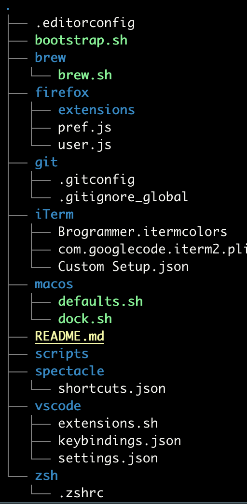

## My dotfiles

These are my dotfiles.
They are very much specific to my use case and needs, but feel free to use them if it also matches your needs.


## Overview


* Target System: macOS
* Target Profile: Profile usage mainly for JVM Software Development
* Status of these dotfiles: WIP

### Main Dependencies
The Homebrew-managed command-line tools are defined in [brew/brew.sh](brew/brew.sh),
including AWS CLI, Git, Go, Helm, JQ, Maven, Minikube, Node, Python, Zsh, and
the shell utilities used by this configuration.

GUI applications are installed separately from Homebrew on this machine. The
personal Dock application list is intentionally kept in the ignored
`macos/private_dock.sh` file.

### GUI Apps
GUI applications are not managed by `brew/brew.sh`; install the applications
you need separately before applying the private Dock configuration.

### Custom aliases

```bash
alias hosts="sudo $EDITOR /etc/hosts"
alias copyssh="more ~/.ssh/id_rsa.pub | pbcopy | echo 'SSH Public key copied to clipboard.'"
alias copygpg="gpg --armor --export <your-email-here> | pbcopy | echo 'GPG Public key copied to clipboard.'"
alias reloadzsh="source ~/.zshrc"
alias configzsh="code ~/.zshrc"
alias ~="cd ~"
```

### Private machine settings

`.env` and `macos/private_dock.sh` are intentionally ignored by Git. Create the
private Dock configuration locally, then set its path in `.env`:

```bash
export PRIVATE_DOCK_CONFIG=macos/private_dock.sh
```

The Dock script loads `.env`, resolves that path from the repository root, and
uses the `DOCK_APPS` array from the private file. This keeps the personal app
list out of the repository.

The iTerm files are templates. Replace `__MACOS_HOME__` with your local home
directory when generating the ignored files:

```bash
source .env
sed "s|__MACOS_HOME__|$MACOS_HOME|g" \
	"iTerm/Custom Setup.json.template" > "iTerm/Custom Setup.json"
sed "s|__MACOS_HOME__|$MACOS_HOME|g" \
	"iTerm/com.googlecode.iterm2.plist.template" \
	> "iTerm/com.googlecode.iterm2.plist"
```

## Installation

```bash
source bootstrap.sh
```

## Credits

* [Getting Started With Dotfiles](https://medium.com/@webprolific/getting-started-with-dotfiles-43c3602fd789)
* [Dotfiles Are Meant to Be Forked](https://zachholman.com/2010/08/dotfiles-are-meant-to-be-forked/)
* [@mathiasbynens and his dotfiles](https://github.com/mathiasbynens/dotfiles)
* [@xbitres and his dotfiles](https://github.com/xbitres/.dotfiles)
* [@pandrez for letting me know about this](https://github.com/pandrez)